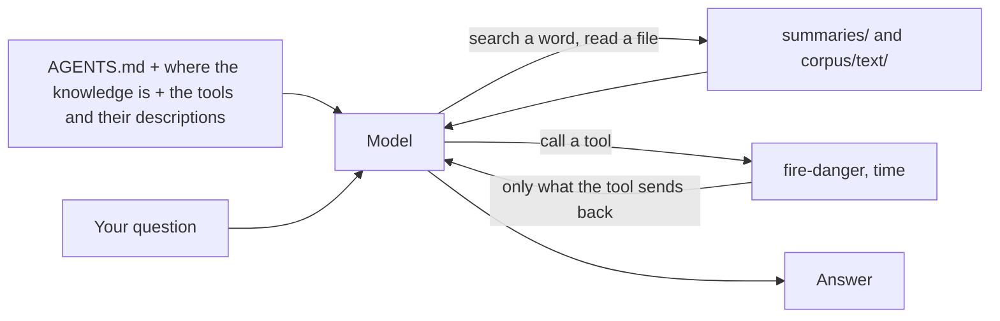
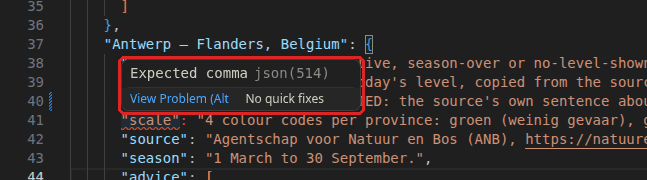
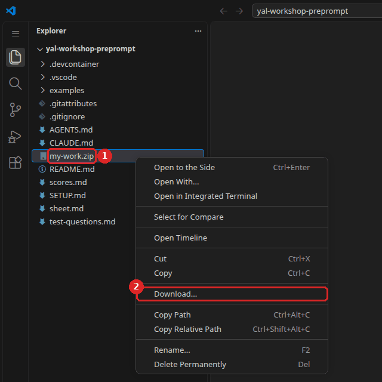
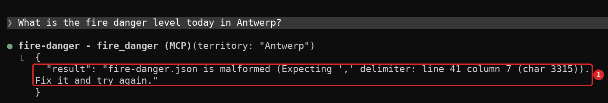

# Workshop 4 - Plug in tools

### Youth AI Lab (Erasmus+) - series "Build your own chatbot", workshop 4 of 6

- **Project:** Youth AI Lab (Erasmus+), with five partners: L.A.B. (Aix-en-Provence, France),
  UAB (Barcelona, Spain), Perlatecnica (Naples, Italy), Digitale Wolven (Antwerp, Belgium),
  CSC Vent des Îles (La Rochelle, France).
- **The series:** [the six workshops](https://github.com/Youth-AI-Lab/yal-workshop-kit#the-series)
- **Need help?**
  - Raise your hand and ask the facilitator.
  - If something breaks, don't panic: your files stay in the Codespace.

> 🎓 **Open your Codespace** (one per pair): 👉 **https://codespaces.new/Youth-AI-Lab/yal-workshop-tools**
>
> **Before you click**, if the idle timeout of this GitHub account is not set yet: do
> [step 1 of SETUP.md](SETUP.md#step-1---let-the-codespace-wait-for-you) (1 minute).
>
> This link creates your own copy of this repository, in VS Code running in your browser. Nothing
> to install. The detailed steps are in [Part 1](#part-1---welcome-20-min).

> 📚 **The slides of the facilitator:** https://youth-ai-lab.github.io/yal-workshop/4/ (the same
> words as this page). **The short version** of this page, on one page: [sheet.md](sheet.md). The
> setup, the commands and the common problems of the whole series: [SETUP.md](SETUP.md).

### Contents

- [Goals of the session](#goals-of-the-session)
- [Part 1 - Welcome (20 min)](#part-1---welcome-20-min)
- [Part 2 - Our tool: today's fire danger level (★★, 20 min)](#part-2---our-tool-todays-fire-danger-level--20-min)
- [Part 3 - Servers that already exist (★★, 30 min)](#part-3---servers-that-already-exist--30-min)
- [Part 4 - Read before you install, and give your source (★★★, 25 min)](#part-4---read-before-you-install-and-give-your-source--25-min)
- [Part 5 - Closing (15 min)](#part-5---closing-15-min)
- [Troubleshooting](#troubleshooting)

---

## Goals of the session

### What you will be able to do by the end of this session

Until now, the chatbot only read what was already in the Codespace: its instructions, its
documents, its skills. Some knowledge changes every day, such as the fire danger level, and no
document can hold it. Today, you plug **tools** into the chatbot: small programs that it can call
while it answers, and that bring back what they find. The question of the day is:

> **What happens when the chatbot acts outside?**

| Bloom level | Parts | You will be able to... | Mode |
|---|---|---|---|
| **Understand** | 2 | Explain why only a tool can give today's level, and read a tool call and what it brought back. | `D` |
| **Apply** | 2, 4 | Fill in the entry of a territory from its official source, so that the tool gives it, with its source. | file |
| **Analyse** | 3 | Compare three tools: what each one reads, what leaves the Codespace, what it costs in the context. | `D` |
| **Evaluate** | 4 | Decide whether to plug in a tool, from what it can do with your rights and what it sends away. | - |

All session long, you go on testing your chatbot with the same questions: today, column **D**,
with questions 8, 11 and 12.

### Why this approach?

A document says what was true the day it was written. The level of fire danger is decided every
day by an authority, and the chatbot cannot guess it. A **tool** fills this gap: the model asks it a
question, the tool answers with a fact, and the model uses it in its answer.

This power has a price. A tool is a program that runs **in your Codespace, with your rights**. It
can read files, and some tools send what the model asks for (a place, a word) to a service on the internet. So
before you plug one in, you read what it does, like an app on your phone before you install it.

Last, a tool is only as good as its data. Our fire danger tool reads a file that **a person** fills
in from the official source, on the day. If nobody has filled it in, the tool says so, and gives
no level.

### How this connects to WikiYouthBot

- **Part 2** gives the chatbot what young people often ask first: "Can we go to the forest today?".
  Only an official source can answer, on the day.
- **Part 4** is a question to ask before any activity with a chatbot that uses tools: what does it
  send outside, and who reads it?
- The same tools can be plugged into an OpenCode chatbot: see the
  [OpenCode guide, Part 6 - Tools with MCP](https://github.com/Youth-AI-Lab/yal-opencode-guide#part-6---tools-with-mcp).

The series goes on, one piece of the chatbot at a time:

- **Workshop 1**: the instructions, and how to test a chatbot
- **Workshop 2**: all the knowledge in the context, then a RAG
- **Workshop 3**: the model searches by itself, and skills
- **Workshop 4** (this one): **tools** that bring today's facts
- **Workshop 5**: organise what it knows in a wiki, and pack the chatbot of your territory
- **Workshop 6**: fine-tune a small model, to sort messages before the chatbot

### Before you start

**Bring `my-work.zip`**, the file you saved at the end of workshop 3. It holds your system prompt,
your question 12, your documents, your summary and your skill. Without it, the kit's example
(Feurisson) becomes your system prompt, and the document of Benevento is added for you. **Bring
also the address of the official page that gives the fire danger level of your territory**, if it
has one: in Part 4, you fill in its entry in the tool's file. More in
[SETUP.md, Before you start](SETUP.md#before-you-start).

### Reference documents

All of these are in your Codespace, in the file list on the left:

- `mcp/fire-danger.json`: the data of our tool, one entry per territory. You fill it in today.
- `mcp/fire_danger_server.py`: the program of our tool, about 160 lines of Python.
- `.mcp.json`: the list of tools that mode D plugs in, and how each one starts.
- `test-questions.md` and `scores.md`: the test set and your score sheet. How to score (0, 1 or
  2) is in `test-questions.md`, "How to score".
- `SETUP.md`: setup, commands and common problems. The gauge (the line `… / 200k` above the input
  box) is explained in [step 4](SETUP.md#step-4---your-first-conversation).

---

## Part 1 - Welcome (20 min)

**Goal**: open the Codespace of this workshop, and bring back your work.

### Step 1 - Open your Codespace and save your key

Follow [SETUP.md](SETUP.md#setup), steps 1 to 5, with the link at the top of this page: let the
Codespace wait for you, open it, save your key with `workshop-login`, check `Key OK`, and open a
second terminal.

> 💡 **If you use OpenCode.** Same commands, after `workshop-login --engine opencode`. Mode D gives
> OpenCode the same tools. It asks you before every shell command and every file it writes, but
> not before it calls one of these tools. With an OpenRouter key (`sk-or-`), the judge of `score`
> does not work: it needs an Anthropic key, so you score alone.

> ℹ️ **No Codespace?** The same repository opens on your own computer, with Docker and VS Code: see
> the [dev containers guide](https://github.com/Youth-AI-Lab/yal-devcontainer-guide).

### Step 2 - Bring back your work

1. **Drag `my-work.zip`** from your computer into the file list of the Codespace. If you
   downloaded it more than once, your browser may have named the newest one `my-work (1).zip`:
   drag that one, and type its exact name between quotes, for example
   `workshop-start 4 --from "my-work (1).zip"`.
2. In your first terminal, type:

   ```bash
   workshop-start 4 --from my-work.zip
   ```

   You should see `Restored from my-work.zip (saved on …)`: check that this date is the end of
   workshop 3. Then the list of the files it restored, and:

   ```
   Prepared for this workshop:
     - nothing needed: everything is already here.

   Ready for workshop 4.
   Today's page: README.md (Ctrl+Shift+V to read it as a page)
   First command: workshop D
   ```

   Without a save, type `workshop-start 4`. The "Prepared" lines then say that `AGENTS.md` is now
   a copy of the Feurisson example, and that the document of Benevento was added to the corpus,
   for question 11.

> ℹ️ **Note.** **The first time you type `workshop D`** in this Codespace, Claude Code asks again
> whether you trust the folder. The choice proposed is `No, exit`: press the **down arrow** to choose
> `Yes, I trust this folder`, then **Enter**. If Claude Code closed, type `workshop D` again. More in
> [SETUP.md, step 4](SETUP.md#step-4---your-first-conversation).

> 💡 **Tip.** **Checkpoint**: `Key OK`, then `Ready for workshop 4`.

---

## Part 2 - Our tool: today's fire danger level (★★, 20 min)

**Goal**: see what our tool knows today, read what it sends back to the model, then fill in the
entry of Antwerp from its official source, and ask again.

### What you will discover

- **A tool** is a small program that the model can call while it answers. It brings back a fact,
  here the level of the day, from a file.
- **MCP** (Model Context Protocol) is the common way to plug such a program into a chatbot: one
  tool program, called a **server**, can be plugged into Claude Code, OpenCode, or another chatbot.
- **The model decides** when to call a tool, from its description. It does not ask you first: the
  workshop allows the tools of mode D.

### What the model reads in mode D



**Key insight:** mode D is mode C plus tools. The model now has two ways to find an answer: read
the documents, or call a tool. What a tool sends back enters the context exactly like a document
it read.

### What to do

#### Step 1 - See the tools of mode D

1. In your first terminal, type `workshop D`.
2. In the conversation, type `/mcp` and press Enter. You should see:

   ```
     Manage MCP servers
     2 servers
       Built-in MCPs (always available)
     ❯ ✔ fire-danger   2 tools
       ✔ time          2 tools
   ```

3. Press Enter on `fire-danger`, then on `1. View tools`: its two tools are `territories` (the
   list of territories it knows) and `fire_danger` (the level of one territory today). Press
   **Esc** until you are back in the conversation.

#### Step 2 - Question 8, before anyone fills in the file

1. Ask question 8 of `test-questions.md`. It is about Antwerp, today.
2. Above the answer, a grey line sums up the tool calls, for example `Called fire-danger 2 times`.
   Press **Ctrl+O** to see each call: the line `● fire-danger - fire_danger (MCP)(territory:
   "Antwerp")` shows what the model asked, and the block under it shows what the tool sent back.
   Press **Ctrl+O** again to come back.

   

3. Read what came back. The file is not dated today, so the tool gives no level
   (`"level": null`), and says why, in a field called `why_no_level`. On screen, the tool sends back
   one long text: each quote has a `\` before it, and `\n` marks a new line. Here it is without them:

   ```
   "why_no_level": "The file is dated YYYY-MM-DD, not today (…). Nobody has filled in today's level yet."
   ```

   What does the model do with it? In our test on 2026-10-30, it called `fire_danger`, then
   `territories` (the list of territories), without asking you, in about 6 seconds, for about
   $0.03.

#### Step 3 - Fill in Antwerp from its official source

The tool reads `mcp/fire-danger.json`. A person fills it in, on the day, from the official source.

1. Open `mcp/fire-danger.json`. Find the entry `"Antwerp - Flanders, Belgium"`. Its `source` gives
   the official page: open it in a browser tab, and read what it says **today**, in the province
   of Antwerp.
2. In the file, write today's date in `"date"`, at the top, in the form year-month-day, for example
   `"2026-11-05"`.
3. In the entry of Antwerp, fill in:
   - `"status"`: `"live"` if the page shows a level for today, `"season-over"` if it says that the
     fire season is over, `"no-level-shown"` if it shows no level today;
   - `"source_says"`: the sentence of the page about today, copied as it is, in its language;
   - only if the status is `"live"`: `"level"`, the level of the day, and the lines of `"advice"`,
     copied as they are.

   Keep the quotes: each value between quotes, a comma between two lines, and none after the last.
   Save (`Ctrl+S`).

> ⚠️ **Important.** **Never make up a level.** Write only what the official source says, on the day.
> If the page shows no level, write the status and its sentence, never a level of your own.

4. In the same conversation, ask question 8 again. The tool reads the file at each call: there is
   nothing to restart. Press **Ctrl+O** again: what changed in what the tool sent back?

> ℹ️ **Note.** **The tool gives a level only when the date is today's and the status is `"live"`.**
> With another status, it gives no level, and says why, with the sentence of the source. An old
> file never passes for today's level. If the chatbot says that `fire-danger.json is malformed`, a
> quote or a comma is missing. The file name turns red, with the number of problems next to it.
> Look for the red wavy line in the editor and put the mouse on it: VS Code says what is missing
> (here: `Expected comma`). A missing comma is usually at the end of the line just above it. Fix
> it and save.




5. Leave with **Ctrl+C twice**.

> 💡 **Tip.** **Checkpoint**: the entry of Antwerp has today's date, a status and the sentence of its
> source, and question 8 gets an answer that names this source.

### Think about it

The model did not know the level of Antwerp, and the tool did not guess it: it read a file that you
filled in. **Who is responsible for the level that the chatbot gives?**

---

## Part 3 - Servers that already exist (★★, 30 min)

**Goal**: use two servers that other people wrote, read how they are plugged in, and see what each
one sends away and what it costs in the context.

### What you will discover

- **Time**: the official example server of MCP. It gives the date and the time in a time zone. It
  calls no service: it reads the clock of the Codespace.
- **Open-Meteo**: a server written by a volunteer, for the weather service of the same name. It
  sends a place and its coordinates to Open-Meteo, on the internet, and brings back the forecast.
- **Each tool has a description**, and the descriptions enter the context with every message, used
  or not.

### Three servers side by side

| Server | Who wrote it | What it reads | What the server itself sends on the internet |
|---|---|---|---|
| `fire-danger` | the workshop | the file `mcp/fire-danger.json` | nothing |
| `time` | the MCP project (official example) | the clock of the Codespace | nothing |
| `open-meteo` | a volunteer (open source) | the Open-Meteo service, on the internet | the place and the coordinates the model asks about |

And for all three: what the tool sends back enters the context, so it goes to the company of the
model (Anthropic) with your question, like everything in the conversation.

**Key insight:** a server is a program that runs in your Codespace with your rights. What it can
do, and what it sends away, is written in its code and in how it is started, not in its name.

### What to do

#### Step 1 - Read how the tools are plugged in

1. Open `.mcp.json`. It lists the servers of mode D: for each one, the program that starts it
   (`command`) and its options (`args`).
2. Find the line of `time`. What option does it get? (`--local-timezone Europe/Paris`: the time
   zone it uses when the model does not name one. In Step 2, watch which time zone the model asks
   for.)

#### Step 2 - A question that needs the time of day

The map of the Pla Alfa, in Catalonia, is updated at fixed hours: the summary of Catalonia says
which. To know whether today's update has already happened, the model needs the time **now**, in
Barcelona. No document holds it.

1. Type `workshop D`, then ask:

   ```
   Has the Pla Alfa map of Catalonia already had its morning update today?
   ```

2. Press **Ctrl+O**: which tools did the model call? Did it ask `time`? Press **Ctrl+O** again.
3. Now ask the same question, naming the tool:

   ```
   Use the time tool: is it already past 9:30 in Barcelona, so that the Pla Alfa map has had its morning update?
   ```

4. Compare the two answers. In our test on 2026-10-30, the model did not call `time` the first time:
   it found the hours of the update in the summary, then said it could not tell. The second time, it
   called `time` (`get_current_time`, time zone `Europe/Madrid`), and answered with the time in
   Barcelona. The date, the model already had: Claude Code gives it, and so does our fire danger tool.
5. Leave with **Ctrl+C twice**.

#### Step 3 - Plug in the weather

The weather tool is not in mode D by default. To plug it in for one conversation, type:

```bash
WORKSHOP_WEATHER=1 workshop D
```

1. Type `/mcp`: you should see a third server, `✔ open-meteo   17 tools`. The workshop shows the
   model **only 2 of them** (the forecast, and the search of a place by its name): the
   descriptions of the 17 tools take about 112,000 characters, 2 of them about 12,000. Press **Esc**.
   The workshop allows these two tools too: the model calls them without asking you, and what it
   sends to them leaves the Codespace.
2. Ask:

   ```
   Will it be windy tomorrow in La Rochelle?
   ```

   Press **Ctrl+O**: what did the model send to Open-Meteo? In our test on 2026-10-30, it sent the
   coordinates of La Rochelle (46.16, -1.15), which it knew without searching, and the answer came
   in about 5 seconds.
3. Now ask: `Given the weather, what is the fire danger level today in La Rochelle?` Does the model
   give a weather forecast as if it were the official level? In our test, it did not: it called the
   fire danger tool, and said that the weather does not give the official level. A test of one
   question proves little: try it yourself.
4. Look at the gauge. In our test, with the weather plugged in, each answer used about 14,000 tokens
   of context, against 8,000 without it. The descriptions of the tools enter the context with every
   message, even when the model does not call them.
5. Leave with **Ctrl+C twice**.

> ℹ️ **Note.** The forecasts come from [Open-Meteo](https://open-meteo.com). Its free service is for
> non-commercial use, and its data is under the CC BY 4.0 licence: a chatbot that shows it must give
> this link.

> ⚠️ **Important.** **Weather is not a fire danger level.** Wind and dry air raise the danger, but the
> level of the day is decided by an authority, with its own scale. If your chatbot mixed them up, add
> a rule to your `AGENTS.md`, for example: `Never give a weather forecast as a fire danger level:
> only the fire-danger tool gives the official level.`

> 💡 **Tip.** **Checkpoint**: you can say, for each of the three servers, what it reads and what
> leaves the Codespace.

### Think about it

The model chose the place and the coordinates, and the weather server sent them to Open-Meteo.
**What else could a server send, if you asked it about a young person's address?**

---

## Part 4 - Read before you install, and give your source (★★★, 25 min)

**Goal**: read what a server really does before you plug it in, then fill in the entry of your own
territory in the tool's file, with its source.

### What you will discover

- **A server starts with your rights.** It can read the files of the Codespace, and some send data
  to a service on the internet. The model decides when to call it, but the program decides what it does.
- **What a tool sends back enters the context.** A web page or an answer from a service can carry
  instructions, like a document. The facilitator shows an example.
- **Your source is part of the data.** The entry of your territory says where the level comes from,
  so that anyone can check it.

### Before you install a server: five questions

| Question | Where to look |
|---|---|
| Who wrote it, and is it still maintained? | its page (GitHub, PyPI, npm): last release, licence |
| What does it read? | its code, and the options in `.mcp.json` |
| What does it send away, and to whom? | its code: the addresses it calls; the terms of the service |
| Does it write or delete anything? | its list of tools: any tool that writes, deletes or sends a message |
| Is its version fixed? | `.mcp.json`, and how it was installed (here: in the image of the Codespace, with fixed versions) |

**Key insight:** a description says what a tool is for. Only its code says what it does. Read both,
or ask someone who can read the code.

### What to do

#### Step 1 - Read our tool

1. Open `mcp/fire_danger_server.py`. You don't need to read Python to see the main facts.
2. Find the two functions marked `@mcp.tool()`: their text between `"""` is the **description** that
   the model reads. Find the line `DATA = …`: the file these two tools read. The line under it,
   `RECORDED = …`, is for a third tool (a past day), which stays off unless the facilitator turns it
   on.

   

3. Answer the five questions above for this server. Does it call any address on the internet?

#### Step 2 - Watch the facilitator's example

The facilitator shows, on the big screen, a web page that hides a sentence for AI assistants. Watch
what the chatbot does with it, then discuss: who wrote this sentence, and who read it?

#### Step 3 - Fill in the entry of your territory

1. Open `mcp/fire-danger.json` again. If your territory is in it (La Rochelle, Aix-en-Provence,
   Barcelona, Antwerp, Naples), fill in its entry as you did for Antwerp in Part 2: `status`,
   `source_says`, and `level` and `advice` only if the status is `"live"`.
2. If your territory is not in the file, copy one entry, paste it after the last one, put a comma
   between the two, and change its name, `scale`, `source` and `season` to those of your territory
   (delete the `season` line, with its comma, if you don't know it).
3. Check that `"date"` is still today's, and save.
4. Type `workshop D` and ask: `What is the fire danger level today in <your territory>?` Press
   **Ctrl+O** to see what the tool sent back (**Ctrl+O** again to come back): does the answer name
   your source?
5. Leave with **Ctrl+C twice**.

> ℹ️ **Note.** **No official daily level in your territory?** Some authorities publish no level out of
> season, or only for the services. Then write `"no-level-shown"` or `"season-over"`, with the
> sentence of the source: a chatbot that says "there is no official level today, here is why" is
> right. Never replace it with another index or a forecast.

> 💡 **Tip.** **Checkpoint**: the entry of your territory has a status, the sentence of its source and
> its address, and the chatbot names this source.

### Think about it

You answered five questions before trusting a server of about 160 lines. **Would you plug in a server you
cannot read, that can write files and send messages, for a chatbot used by young people?**

> **You built** the entry of your territory in a live tool, with its source. **Reused in** any chatbot
> that uses tools: in OpenCode, [the fire-danger example and how to fill in today's level](https://github.com/Youth-AI-Lab/yal-opencode-guide#fill-in-todays-level),
> and the checks of [Other MCP servers](https://github.com/Youth-AI-Lab/yal-opencode-guide#other-mcp-servers).

---

## Part 5 - Closing (15 min)

### Step 1 - Replay and score column D

1. **Predict** on paper: which of questions 8, 11 and 12 will go up from column C to column D?
2. In your first terminal, replay the test set in mode D:

   ```bash
   replay D
   ```

   Under each answer, the line `What the model did:` lists what it read and searched, and the tools
   it called, for example `called the MCP tool fire_danger`. In our test on 2026-10-30, with the 11
   questions of the kit (no question 12): 1 min 54 and $0.24. Other ways to pay for the model:
   [OpenCode guide, five ways to pay for the model](https://github.com/Youth-AI-Lab/yal-opencode-guide#before-you-start-five-ways-to-pay-for-the-model).
3. Score only the three questions of today, with the help of the judge (no question 12:
   `score D 8 11`):

   ```bash
   score D 8 11 12
   ```

   For question 8: when the entry of Antwerp is not `"live"`, an answer that says there is no
   official level today, with the sentence of the source, is right.
4. **Compare column D** with column C in `scores.md`, for questions 8, 11 and 12, and with your
   prediction. Which question changed, and why? Today only some questions are scored, so **the
   Total row means nothing here**: read the rows. If column C has no score for question 8, type
   `score C 8`: your answers of workshop 3 are still in `answers/`. Without a save, there is no
   column C: compare with a neighbouring pair.

### Step 2 - Save your work, fill in the exit card

1. Type `workshop-save`, then right-click on `my-work.zip` → **Download...**. It holds your
   `fire-danger.json` and everything before. Bring it to workshop 5.

   

   If your computer already has a `my-work.zip`, the new one may be called `my-work (1).zip`:
   bring the newest.
2. Answer on the card of the facilitator, alone, in a few words:
   1. Why can only a tool give today's fire danger level?
   2. What can a server do in your Codespace, and how do you check it before you plug it in?
   3. What is the difference between a weather forecast and the official fire danger level?

**Next:** [Workshop 5 - Organise what it knows](https://github.com/Youth-AI-Lab/yal-workshop-wiki). Open its own Codespace from that page, and
bring `my-work.zip`.

---

## Troubleshooting

The common problems (key, Codespace, terminal) are in the
[Troubleshooting of SETUP.md](SETUP.md#troubleshooting).

**`fire-danger.json is malformed (Expecting ',' delimiter: line … column …). Fix it and try again.`** -
A comma or a quote is missing in `mcp/fire-danger.json`. Go to the line given in the message and
look for the red underline in the editor. A missing comma is usually at the end of the line just
above it. Fix it, and save. You don't need to restart the conversation.



**The tool says "The file is dated …, not today".** - Write today's date in `"date"`, at the top of
the file, in the form year-month-day, and save.

**The tool gives no level, although I wrote one.** - The tool gives a level only when the status is
`"live"`. With `"season-over"` or `"no-level-shown"`, it gives the sentence of the source instead.

**`/mcp` shows a server with ✘ instead of ✔.** - Leave the conversation (**Ctrl+C twice**) and start
`workshop D` again. If it stays ✘, ask the facilitator.

**The model does not call the tool.** - Ask about **today**, and name the territory as it is written
in the file (`territories` gives the list). A question about the rules (what is forbidden, the
fines) is answered from the documents, not by the tool.

**`WORKSHOP_WEATHER=1 works with modes D, E and F only.`** - Type `WORKSHOP_WEATHER=1 workshop D`,
not with another mode.

---

Texts and screenshots: [CC BY-SA 4.0](LICENSES/CC-BY-SA-4.0.txt). Configuration and programs:
[EUPL-1.2](LICENSES/EUPL-1.2.txt). The official documents are not ours and are not covered: see
[their note](LICENSES/LicenseRef-Third-Party.txt) and [`REUSE.toml`](REUSE.toml).

*Youth AI Lab (Erasmus+) - Workshop 4 of the series "Build your own chatbot" - 2026*
